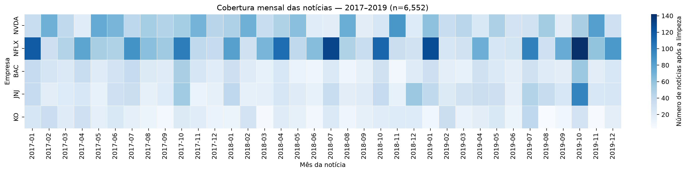

# Sentimento das notícias e comportamento de ações dos EUA

Projeto de **Análise Exploratória de Dados e Visualização — FGV EMAp, 2026.2**.

**Integrantes:** Caio Ladislau do Couto, Alice Barros Lourencini Palaoro e Mateus Henrique da Costa Resende.

## Objetivo

Investigar associações descritivas entre o tom de manchetes financeiras e os retornos e oscilações de NVIDIA (NVDA), Netflix (NFLX), Bank of America (BAC), Johnson & Johnson (JNJ) e Coca-Cola (KO), em **2017–2019**, sem atribuir causalidade. A contribuição central é a visualização e a interpretação dos dados.

## Estado do projeto — 15/10/2026

| Etapa | Resultado registrado |
| --- | --- |
| Limpeza das notícias | 6.556 associações no recorte, quatro duplicatas removidas e **6.552 mantidas** |
| Cotações | **754 pregões por empresa** no recorte, com margem antes/depois e sem lacunas entre as cinco séries na coleta registrada |
| Classificação FinBERT | **6.019 textos distintos**, recompostos nas 6.552 associações originais |
| Sentimento diário | **2.569 pares empresa/data da notícia**, com probabilidades médias, escore, classe e contagem |
| Revisão qualitativa inicial | **50/50 casos preenchidos** por caio, com observações e identificação do revisor; **39 concordâncias e 11 divergências** |
| Integração com pregões e retornos | **Concluída**: 6.552 notícias mapeadas, painel de 3.770 pares empresa/pregão e calendário XNYS validado |
| Visualizações e narrativa analítica | Cobertura inicial disponível; gráficos de sentimento, retornos e robustez pendentes |

A classificação, a agregação por data civil e a revisão qualitativa inicial estão registradas. As 39 concordâncias em 50 casos descrevem uma **amostra dirigida**, incluindo casos difíceis; não estimam a acurácia geral do modelo. Os rótulos humanos permanecem separados das previsões automáticas. Consulte [o relatório da revisão](docs/finbert.md).

As células de preparação, sentimento e integração foram verificadas por execução sequencial em cópia local. A integração fixou o snapshot de preços de 09/10 e conferiu o calendário histórico XNYS, com revisão independente dos comunicados ICE/NYSE. Consulte [o método, as bordas do recorte e os resultados da integração](docs/integracao.md). A reprodução por outro integrante continua recomendada para a entrega do grupo.



## Como executar

1. Clone o repositório e entre na pasta do projeto. Use **Python 3.11** com as dependências de `requirements.txt`.
2. Se utilizar o ambiente local já configurado, ative `aed-sentimento`. No Jupyter, selecione o kernel **Python (AED Sentimento)**. Em outro computador, crie um ambiente e instale as dependências:
   ```text
   python -m pip install -r requirements.txt
   python -m ipykernel install --user --name aed-sentimento --display-name "Python (AED Sentimento)"
   ```
3. Baixe `raw_analyst_ratings.csv` do [dataset do Kaggle](https://www.kaggle.com/datasets/miguelaenlle/massive-stock-news-analysis-db-for-nlpbacktests) e coloque em `data/raw/`.
4. Execute **`notebooks/01_preparacao_inicial.ipynb`** em ordem. Ele gera `data/processed/noticias_limpas.csv` e as cotações tratadas. Sem snapshot de cotações, a coleta usa internet; para reprodução exata, obtenha o snapshot do grupo e confira os hashes.
5. Execute **`notebooks/02_sentimento_finbert.ipynb`** em ordem. O primeiro carregamento permite baixar a revisão fixada do modelo; depois os pesos ficam no cache do Hugging Face. O cache de probabilidades é local e permite retomar a classificação.
6. Execute **`notebooks/03_integracao_retornos.ipynb`** em ordem. Ele usa as notícias classificadas e as cotações com margem, confere os hashes do snapshot, valida o calendário e gera `base_integrada_pregoes.csv`. Instale a nova dependência `exchange-calendars==4.13.2` por meio de `requirements.txt`. Para reproduzir a execução datada, use as entradas do pacote validado; outra coleta deve ser assumida explicitamente conforme o notebook.
7. Confira os CSVs em `data/processed/`, o manifesto local em `docs/manifesto_finbert.json` e o estado da revisão. A [amostra humana já preenchida](docs/revisao_manual/amostra_50_cf0a9799_e1f584a3.csv) é preservada pelo notebook. O leitor aceita vírgula ou ponto e vírgula.

Os resultados completos, o CSV original, os snapshots e os pesos não estão versionados. A amostra humana e o [registro datado da execução](docs/execucoes/finbert_2026-10-15.json) estão versionados. As versões observadas estão nesse registro; `requirements.txt` não é um lock completo do ambiente.

## Fontes e método

- **Notícias:** [Daily Financial News for 6000+ Stocks](https://www.kaggle.com/datasets/miguelaenlle/massive-stock-news-analysis-db-for-nlpbacktests). SHA-256 do original utilizado: `609289a49dc8af2bd28a8466dffd9663521237026f1040c0f238010b29135fb6`.
- **Preços:** [Yahoo Finance via yfinance](https://ranaroussi.github.io/yfinance/reference/api/yfinance.download.html), fechamento ajustado e volume, de 15/12/2016 até 11/01/2020 (fim exclusivo). Há coletas locais com pequenas diferenças de ajuste; documente o snapshot adotado e não substitua uma coleta silenciosamente.
- **Sentimento:** [ProsusAI/finbert](https://huggingface.co/ProsusAI/finbert), revisão `4556d13015211d73dccd3fdd39d39232506f3e43`, sem treinamento. Escore `P(positivo) − P(negativo)`. A classe diária é a maior probabilidade média, com empates explícitos. A probabilidade softmax não é uma probabilidade calibrada de acerto.

As manchetes compartilhadas entre empresas foram mantidas e sinalizadas. O modelo classifica o tom do texto inteiro, que pode não representar igualmente cada empresa citada. Dias sem notícias não são neutros. A revisão inicial registra divergências e subjetividade, sem sobrescrever automaticamente os rótulos do modelo.

O notebook 02 mantém o agregado por **data civil da notícia**. O notebook 03 já mapeia cada notícia ao **primeiro pregão estritamente posterior** e reagrupa por **empresa/pregão**, com peso igual por manchete. O painel principal contém 3.770 pares de 2017–2019; 2.390 têm notícias no recorte e 2.387 também têm janela completa. Para comparar sentimento e retorno, filtre `tem_noticias & elegivel_analise_principal`. Seis notícias com retorno em janeiro de 2020 são preservadas como margem, fora do painel principal. O retorno absoluto mede magnitude da mudança diária, sem ser uma estimativa formal de volatilidade. Manchetes podem relatar movimentos já ocorridos; os resultados serão interpretados como associações.

## Próximos passos e entregas

1. Desenvolver os gráficos de composição e evolução do sentimento, associações com retornos e diferenças entre empresas e anos.
2. Definir e aplicar os filtros de robustez, documentar amostras restantes e escrever as interpretações.
3. Consolidar o notebook em formato de artigo e preparar a apresentação intermediária.

- **29/10/2026:** notebook-artigo intermediário e apresentação de cinco minutos.
- **Semana A2:** notebook final, repositório, apresentação de dez minutos e declaração de contribuições. A janela 23–30/11 foi informada pelo grupo; confirmar o dia exato. Meta interna: 22/11.

Consulte [os documentos e registros](docs/README.md). Registrem contribuições, revisões e retorno do professor durante o trabalho.
